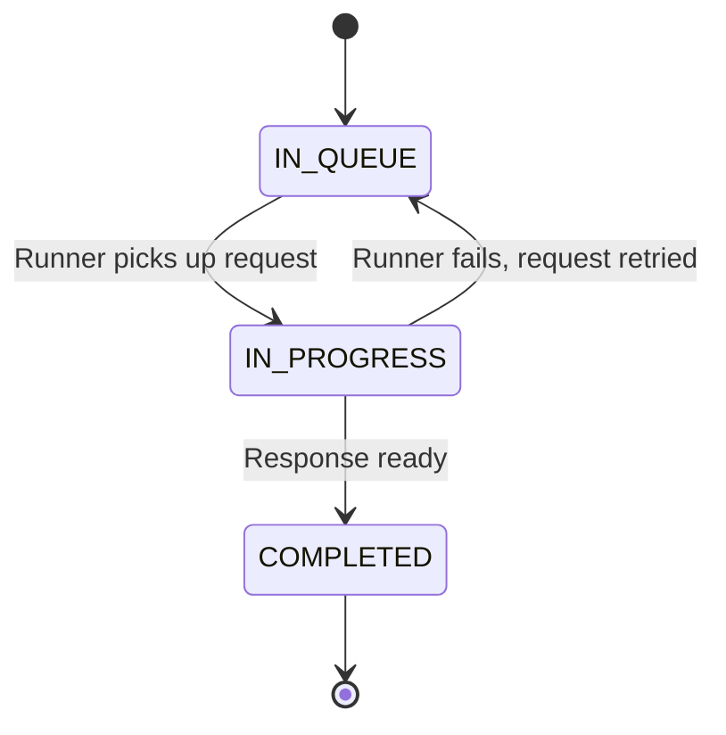
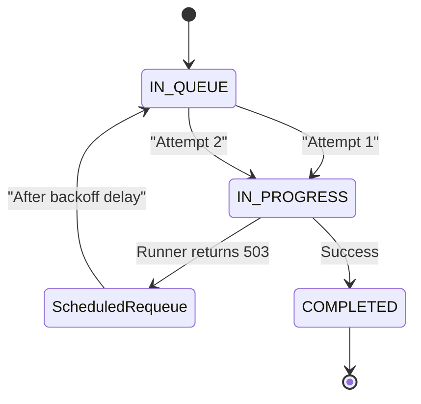

> ## Documentation Index
> Fetch the complete documentation index at: https://fal.ai/docs/llms.txt
> Use this file to discover all available pages before exploring further.

> ## Agent Instructions
> fal has two developer products. Model APIs run hosted models through an API key. fal Serverless deploys your own Python apps and models on fal GPUs.
> To call a hosted model, start with the [Quick Start](../quickstart.md) and the [Model APIs overview](../model-apis/overview.md).
> To deploy your own model with fal Serverless, start with these pages:
> - [Introduction to Serverless](../serverless.md): What fal Serverless is and the three ways to deploy on it.
> - [Installation & Setup](../development/getting-started/installation.md): Install the fal CLI with `pip install fal` and authenticate.
> - [Quick Start](../development/getting-started/quick-start.md): Build a Hello World app, test it with `fal run`, and ship it with `fal deploy`.
> - [App Lifecycle](../development/app-lifecycle.md): How a `fal.App` goes from code to running runners.
> - [Define Your Endpoints](../development/endpoints-overview.md): Structure the API endpoints that your app exposes.
> - [Deploy to Production](deploy-to-production.md): Persistent URLs, authentication modes, and automatic scaling.
> - [Machine Types](machine-types.md): Available GPU and CPU machine types and how to choose one.
> - [Pricing](../serverless/pricing.md): Per-second billing and the runner states that are billed.
> - [Scaling Parameter Reference](scale-your-application.md): Parameters that control runners, concurrency, and scale to zero.
> - [Optimizing Cold Starts](../serverless/optimizations/optimize-cold-starts.md): Causes of cold starts and ways to make them shorter.
> - [Examples](../../examples.md): Complete Serverless apps for image, video, audio, 3D, realtime, and multi-GPU workloads.
> - [Migrating to fal](../development/migrating-to-fal.md): Guides to move an existing Docker server or an app from another platform to fal.
> fal Serverless deploys need access that the fal team approves for each account. Request access at https://fal.ai/dashboard/serverless-get-started.

# Request Lifecycle: Queue States and Retries

> How a fal request moves through the queue: IN_QUEUE, IN_PROGRESS, and COMPLETED states, request_id polling, start_timeout, and automatic retries.

When you call a model or your own deployed app on fal, the request passes through several layers before your code processes it and returns a result. Understanding these layers helps you reason about latency, retries, timeouts, and why requests behave the way they do. This page covers the request lifecycle from the caller's perspective down to the runner, and how requests interact with [runners](runners.md) and the [retry system](../serverless/reliability/retries.md).

fal's infrastructure is built around a persistent queue that decouples callers from runners. When you use queue-based methods ([`submit()`](../model-apis/inference/queue.md), [`subscribe()`](../model-apis/inference/synchronous.md)), your request enters the queue and benefits from automatic retries, status tracking, and durability. Direct methods ([`run()`](../model-apis/inference/synchronous.md), [`stream()`](../model-apis/inference/streaming.md)) bypass the queue and connect straight to a runner, which is faster but means no retries and no status polling. Both paths share the same runner and scaling infrastructure underneath.

## Request Lifecycle (Queue-Based)

When using `submit()` or `subscribe()`, a request moves through three states visible to callers via the [queue status API](../model-apis/inference/queue.md#check-status). Direct calls via `run()` and `stream()` bypass the queue entirely and do not have these states.

| State | What is happening | Caller sees |
| - | - | - |
| **IN\_QUEUE** | Request is waiting in the queue for an available runner | `queue_position` indicating how many requests are ahead |
| **IN\_PROGRESS** | A runner is executing your endpoint handler | [`logs`](../development/logging.md) from your code (when enabled) |
| **COMPLETED** | Result is stored and ready for retrieval | Full response payload |

Cancellation is handled separately from the status lifecycle. When a caller [cancels a request](../model-apis/inference/queue.md#cancel-a-request), queued requests are removed from the queue and in-progress requests receive a [cancellation signal](../development/handle-cancellations.md). The cancel API returns `CANCELLATION_REQUESTED` (202) or `ALREADY_COMPLETED` (400) rather than transitioning to a pollable status.

### How Requests Flow

**1. Submission**

The caller submits a request via the [SDK](../model-apis/inference.md) or REST API. fal assigns a [`request_id`](../model-apis/inference/queue.md#submit-a-request) and places the request in the persistent queue. The request enters `IN_QUEUE` state. By default there is no queue size limit and requests are never dropped. Callers can optionally set [`fal_max_queue_length`](../model-apis/common-parameters.md#fal-max-queue-length) to reject requests with 429 if the queue exceeds a threshold.

**2. Dispatch**

The dispatcher checks for available IDLE [runners](runners.md). If a runner is free, the request is routed immediately and enters `IN_PROGRESS`. If all runners are busy, the request waits in the queue while fal [scales up](scale-your-application.md) new runners. Runners with matching [routing hints](https://fal.ai/docs/documentation/serverless/optimizations/optimize-routing-behavior.md) are preferred when available.

**3. Processing**

The runner receives the request as a standard HTTP call. Your [endpoint handler](../development/endpoints-overview.md) runs, processes the input, and returns a response. The runner transitions from RUNNING back to IDLE. If the runner fails, the request is [retried](../serverless/reliability/retries.md) automatically.

**4. Result**

The response is stored and the request enters `COMPLETED`. The caller retrieves the result by [polling or streaming status](../model-apis/inference/queue.md#check-status), or receives it via [webhook](../model-apis/inference/webhooks.md). For direct `run()` calls, the response is returned in the same HTTP connection.

Your endpoint code receives every request as a regular HTTP call. It does not matter whether the caller used `run()`, `submit()`, or `stream()`. The queue and dispatch layer are transparent to your app code.

## Requests and Retries

Retries only apply to queue-based requests. Direct calls via `run()` and `stream()` return errors immediately with no retry.

When a runner fails while processing a queued request, the request is placed in a scheduled requeue with a backoff delay, then re-enters the queue and is dispatched to a different runner. This happens automatically for server errors (503), timeouts (504), and connection failures, up to 10 attempts. The retry is transparent to the caller -- they continue polling the same `request_id` and eventually get a result or a final failure.

The [`start_timeout`](../model-apis/inference/queue.md#start-timeout) clock runs continuously across all retry attempts. If you set `start_timeout=30` and the first attempt fails after 20 seconds, the second attempt only has 10 seconds left before the server returns 504. This prevents retries from running indefinitely.

You can control retry behavior at three levels: app-level with [`skip_retry_conditions`](../serverless/reliability/retries.md#app-level-skip_retry_conditions), per-response with the [`X-Fal-Needs-Retry`](../serverless/reliability/retries.md#per-response-x-fal-needs-retry) header, and per-request with the [`X-Fal-No-Retry`](../serverless/reliability/retries.md#per-request-client-side-control) header from the caller.

> [card] [Understanding Runners](runners.md)
>
> Runner lifecycle states, startup, shutdown, and scaling

> [card] [Retries and Error Handling](../serverless/reliability/retries.md)
>
> Status codes, response headers, timeouts, and retry control

> [card] [Caching](caching.md)
>
> How cold start caching affects request latency

> [card] [Handle Cancellations](../development/handle-cancellations.md)
>
> Implement cancel endpoints for in-progress requests
