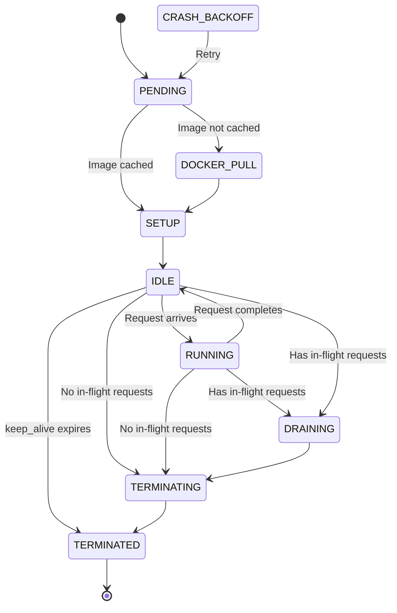

> ## Documentation Index
> Fetch the complete documentation index at: https://fal.ai/docs/llms.txt
> Use this file to discover all available pages before exploring further.

> ## Agent Instructions
> fal has two developer products. Model APIs run hosted models through an API key. fal Serverless deploys your own Python apps and models on fal GPUs.
> To call a hosted model, start with the [Quick Start](../quickstart.md) and the [Model APIs overview](../model-apis/overview.md).
> To deploy your own model with fal Serverless, start with these pages:
> - [Introduction to Serverless](../serverless.md): What fal Serverless is and the three ways to deploy on it.
> - [Installation & Setup](../development/getting-started/installation.md): Install the fal CLI with `pip install fal` and authenticate.
> - [Quick Start](../development/getting-started/quick-start.md): Build a Hello World app, test it with `fal run`, and ship it with `fal deploy`.
> - [App Lifecycle](../development/app-lifecycle.md): How a `fal.App` goes from code to running runners.
> - [Define Your Endpoints](../development/endpoints-overview.md): Structure the API endpoints that your app exposes.
> - [Deploy to Production](deploy-to-production.md): Persistent URLs, authentication modes, and automatic scaling.
> - [Machine Types](machine-types.md): Available GPU and CPU machine types and how to choose one.
> - [Pricing](../serverless/pricing.md): Per-second billing and the runner states that are billed.
> - [Scaling Parameter Reference](scale-your-application.md): Parameters that control runners, concurrency, and scale to zero.
> - [Optimizing Cold Starts](../serverless/optimizations/optimize-cold-starts.md): Causes of cold starts and ways to make them shorter.
> - [Examples](../../examples.md): Complete Serverless apps for image, video, audio, 3D, realtime, and multi-GPU workloads.
> - [Migrating to fal](../development/migrating-to-fal.md): Guides to move an existing Docker server or an app from another platform to fal.
> fal Serverless deploys need access that the fal team approves for each account. Request access at https://fal.ai/dashboard/serverless-get-started.

# Understanding Runners

> What runners are, how they start, process requests, scale, and shut down.

A runner is a compute instance of your application running on fal's infrastructure. When you [deploy](deploy-to-production.md) an app, fal creates runners on demand to handle incoming requests. Each runner is tied to a specific [machine type](machine-types.md) that determines its hardware resources (CPU cores, RAM, GPU type and count). Runners automatically start when requests arrive and shut down when idle, so you only pay for compute you actually use.

Understanding the runner lifecycle is essential for making good decisions about [scaling](scale-your-application.md), [cold start optimization](../serverless/optimizations/optimize-cold-starts.md), and [cost management](../serverless/optimizations/optimizing-costs.md). Every scaling parameter, every caching strategy, and every startup optimization ultimately affects how runners behave. This page covers what happens from the moment a runner is scheduled to the moment it shuts down. For how requests flow through the queue and interact with runners, see [Understanding Requests](requests.md).

## Runner Lifecycle and States

Runners transition through a sequence of states during their lifetime. The startup flow determines your cold start latency, and the shutdown flow determines how gracefully your app handles scale-down events.

| State | Description |
| :- | :- |
| **PENDING** | Runner is waiting to be scheduled on available hardware |
| **DOCKER\_PULL** | Pulling Docker image from registry (skipped when image is [cached](caching.md)) |
| **SETUP** | Running [`setup()`](../development/app-lifecycle.md) method, loading model and initializing resources |
| **CRASH\_BACKOFF** | Previous runner startup failed; delaying this runner's start before retrying |
| **IDLE** | Ready and waiting for work, no active requests |
| **RUNNING** | Actively processing one or more [requests](requests.md) |
| **DRAINING** | Finishing current requests, won't accept new ones |
| **TERMINATING** | Shutting down, running [`teardown()`](../development/app-lifecycle.md) if defined |
| **TERMINATED** | Runner has stopped and resources are released |

### Startup

When demand increases, fal schedules a new runner. If the runner's Docker image isn't already [cached](caching.md), it's pulled first (DOCKER\_PULL). Then your [`setup()`](../development/app-lifecycle.md) method runs to load models and initialize resources. Once setup completes and the health check passes, the runner enters IDLE and is ready to serve requests. The time from PENDING to IDLE is your cold start latency.

### Startup Failure

If a runner crashes during startup or `setup()` times out, the runner is terminated. To prevent a tight crash loop, the system applies an incremental backoff to all subsequent runner starts for the same app. When a new runner is about to start and previous runners have failed, it enters `CRASH_BACKOFF` -- a holding state where the runner waits before attempting allocation.

The backoff works as follows:

* Each subsequent runner start is delayed by an additional 30 seconds (e.g. 30s, 60s, 90s)
* The delay is capped at 10 minutes
* If any runner succeeds during the delay, all waiting runners are woken up immediately and the backoff resets
* Scheduling failures (when hardware isn't available) also trigger a delay, but use a fixed 20-second wait instead of incremental backoff

After the delay, the runner transitions back to `PENDING` and retries the full startup flow.

When you see runners in `CRASH_BACKOFF`, check your `setup()` method and runner logs for errors. Common causes include missing model files, out-of-memory errors during model loading, and dependency issues.

### Request Processing

When a request arrives, an IDLE runner transitions to RUNNING. After completing all requests, it returns to IDLE. Runners can handle multiple concurrent requests if [`max_multiplexing`](scale-your-application.md) is set above 1.

### Shutdown

Runners shut down through different paths depending on their state:

* **[`keep_alive`](scale-your-application.md) expiration:** An idle runner with no in-flight requests is terminated directly. The system sends SIGTERM, runs your [`teardown()` method](../development/app-lifecycle.md) for cleanup, and then releases resources.
* **Scale-down with in-flight requests:** The runner enters DRAINING. No new requests are routed, but existing requests continue processing. After requests complete, the runner enters TERMINATING, runs `teardown()`, and is terminated.
* **Scale-down with no in-flight requests:** The runner skips DRAINING and enters TERMINATING immediately.
* **Manual stop/kill:** You can terminate runners manually using [`fal runners stop`](../../api-reference/cli/runners.md#stop) or [`fal runners kill`](../../api-reference/cli/runners.md#kill), or from the dashboard.
* **Host maintenance:** The runner may be terminated if the underlying host is being drained due to a maintenance event (GPU errors, networking issues, or scheduled infrastructure updates).

For details on startup and shutdown hooks (`setup()`, `handle_exit()`, `teardown()`), see [App Lifecycle](../development/app-lifecycle.md).

> [card] [Understanding Requests](requests.md)
>
> Request lifecycle, retry interaction, and how requests flow through the queue to runners

> [card] [Debugging Runners](debug-runners.md)
>
> Shell into live runners or run one-off commands with the fal CLI

> [card] [Caching](caching.md)
>
> How fal's multi-layer cache reduces cold start times

> [card] [CLI: fal runners](../../api-reference/cli/runners.md)
>
> List runners, filter by state, view history, and get runner details

> [card] [App Analytics](../serverless/observability/app-analytics.md)
>
> Dashboard metrics for requests, runners, and performance
