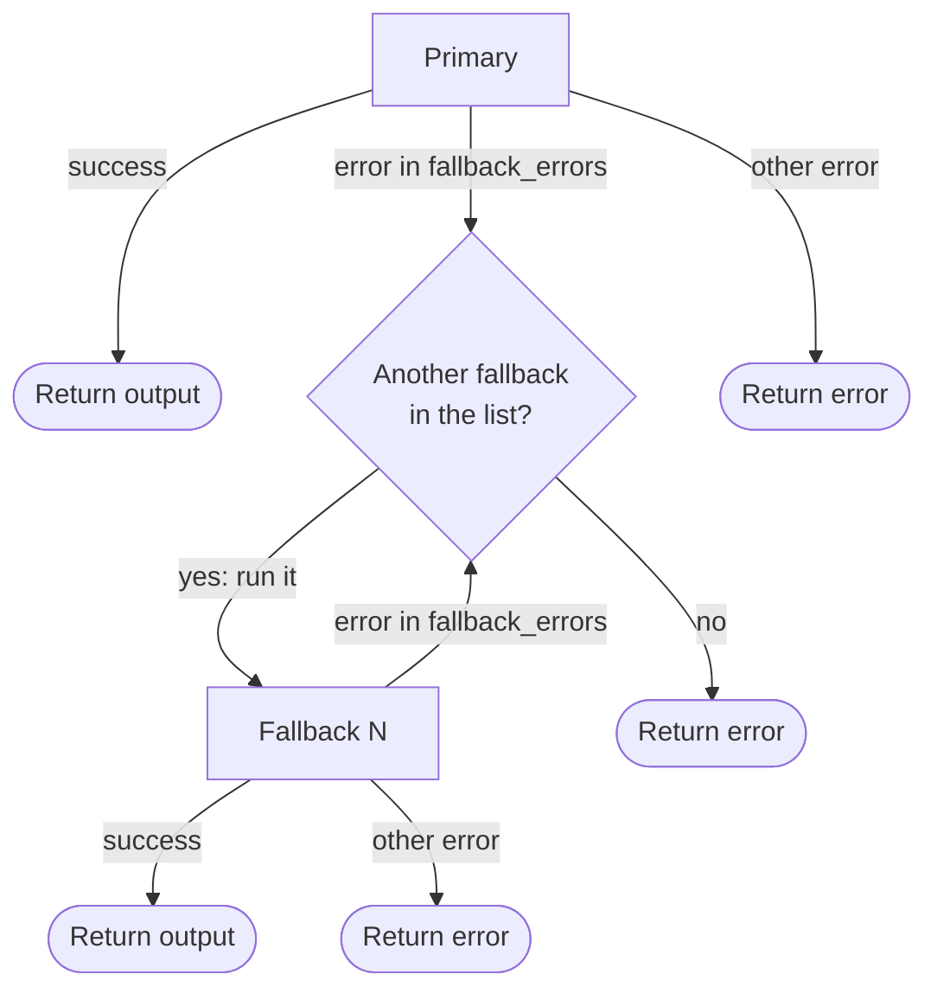

> ## Documentation Index
> Fetch the complete documentation index at: https://fal.ai/docs/llms.txt
> Use this file to discover all available pages before exploring further.

> ## Agent Instructions
> fal has two developer products. Model APIs run hosted models through an API key. fal Serverless deploys your own Python apps and models on fal GPUs.
> To call a hosted model, start with the [Quick Start](../../quickstart.md) and the [Model APIs overview](../overview.md).
> To deploy your own model with fal Serverless, start with these pages:
> - [Introduction to Serverless](../../serverless.md): What fal Serverless is and the three ways to deploy on it.
> - [Installation & Setup](../../development/getting-started/installation.md): Install the fal CLI with `pip install fal` and authenticate.
> - [Quick Start](../../development/getting-started/quick-start.md): Build a Hello World app, test it with `fal run`, and ship it with `fal deploy`.
> - [App Lifecycle](../../development/app-lifecycle.md): How a `fal.App` goes from code to running runners.
> - [Define Your Endpoints](../../development/endpoints-overview.md): Structure the API endpoints that your app exposes.
> - [Deploy to Production](../../deployment/deploy-to-production.md): Persistent URLs, authentication modes, and automatic scaling.
> - [Machine Types](../../deployment/machine-types.md): Available GPU and CPU machine types and how to choose one.
> - [Pricing](../../serverless/pricing.md): Per-second billing and the runner states that are billed.
> - [Scaling Parameter Reference](../../deployment/scale-your-application.md): Parameters that control runners, concurrency, and scale to zero.
> - [Optimizing Cold Starts](../../serverless/optimizations/optimize-cold-starts.md): Causes of cold starts and ways to make them shorter.
> - [Examples](../../../examples.md): Complete Serverless apps for image, video, audio, 3D, realtime, and multi-GPU workloads.
> - [Migrating to fal](../../development/migrating-to-fal.md): Guides to move an existing Docker server or an app from another platform to fal.
> fal Serverless deploys need access that the fal team approves for each account. Request access at https://fal.ai/dashboard/serverless-get-started.

# Fallback Chains

> Run a primary model with up to two fallback models in one synchronous request.

A fallback chain is a list of up to three models that you send in one request to `POST https://fal.run/execute`. fal runs the first model, which is the primary. If the primary fails with an error that you allow, fal runs the next model in the list. The response contains the first successful result and a record of each attempt.

Use a fallback chain when a different model can give an acceptable result if your preferred model is not available. For example, you can send an image request to a fast model first and to a second model if the first model times out.

> [!NOTE]
>
> A fallback chain is different from [model fallbacks](reliability.md#model-fallbacks). Model fallbacks are automatic and fal selects the alternative endpoint. In a fallback chain, you select the models, the input for each model, and the errors that move the request to the next model.
>
> Some models apply their own automatic model fallbacks. These still run inside each attempt, independent of your fallback chain. To disable them, pass the `x-app-fal-disable-fallback: true` header in your request.

> [!WARNING]
>
> You can add **up to two fallback models** to a chain. With the primary model, a chain has at most three models.

## Quick Start

Send the primary model in `endpoint`, `input`, and `config`. Send each fallback model in the `fallback` list.

```bash cURL theme={null}
curl -X POST "https://fal.run/execute" \
  -H "Authorization: Key $FAL_KEY" \
  -H "Content-Type: application/json" \
  -d '{
    "endpoint": "fal-ai/flux/schnell",
    "input": {"prompt": "a sunset over mountains"},
    "config": {"start_timeout": 10},
    "fallback": [
      {
        "endpoint": "fal-ai/flux/dev",
        "input": {"prompt": "$input.prompt", "num_inference_steps": 28}
      }
    ]
  }'
```

```python Python theme={null}
import os

import httpx

response = httpx.post(
    "https://fal.run/execute",
    headers={"Authorization": f"Key {os.environ['FAL_KEY']}"},
    json={
        "endpoint": "fal-ai/flux/schnell",
        "input": {"prompt": "a sunset over mountains"},
        "config": {"start_timeout": 10},
        "fallback": [
            {
                "endpoint": "fal-ai/flux/dev",
                "input": {"prompt": "$input.prompt", "num_inference_steps": 28},
            }
        ],
    },
    timeout=300,
)
result = response.json()

if result["status"] == "OK":
    print(result["endpoint"], result["output"]["images"][0]["url"])
else:
    print(result["reason"], result["message"])
```

```javascript JavaScript theme={null}
const response = await fetch("https://fal.run/execute", {
  method: "POST",
  headers: {
    Authorization: `Key ${process.env.FAL_KEY}`,
    "Content-Type": "application/json",
  },
  body: JSON.stringify({
    endpoint: "fal-ai/flux/schnell",
    input: { prompt: "a sunset over mountains" },
    config: { start_timeout: 10 },
    fallback: [
      {
        endpoint: "fal-ai/flux/dev",
        input: { prompt: "$input.prompt", num_inference_steps: 28 },
      },
    ],
  }),
});
const result = await response.json();

if (result.status === "OK") {
  console.log(result.endpoint, result.output.images[0].url);
} else {
  console.log(result.reason, result.message);
}
```

In this example, `fal-ai/flux/schnell` must start in 10 seconds. If it does not start in this time, fal runs `fal-ai/flux/dev` with the same prompt.

> [!NOTE]
>
> The fal client libraries do not have a method for fallback chains. Send the request with an HTTP client, as the examples show.

## How a Chain Runs



fal runs the models one at a time, in the order of the list. `Fallback N` is the next model in the `fallback` list, first `fallback[0]` and then `fallback[1]`. Each attempt is a separate request with its own request ID. A model moves the chain to the next model only when its [error category](#error-categories) is in its own `fallback_errors`.

* **Return output**: the response has `"status": "OK"` and the output of the model that succeeded.
* **Return error**: the response has `"status": "ERROR"` and the error of the last model that ran.

See [Response Format](#response-format) for the full response.

## Request Format

| Field | Type | Description |
| - | - | - |
| `endpoint` | string | The endpoint ID of the primary model, for example `fal-ai/flux/schnell`. A subpath is allowed, for example `fal-ai/flux-lora/image-to-image`. |
| `input` | object | The input of the primary model. This is the same body that you send to `https://fal.run/<endpoint>`. |
| `config` | object | Optional. The settings of the primary model. Each fallback model has its own `config` in its `fallback` item. See [Model Settings](#model-settings). |
| `fallback` | array | Optional. Up to two fallback models. Each item has its own `endpoint`, `input`, and optional `config`. |

### Model Settings

Each model in the chain has its own `config`. The top-level `config` applies only to the primary model. A fallback model does not inherit it. If a fallback item has no `config`, that model uses the default values.

```json theme={null}
{
  "endpoint": "fal-ai/primary-model",
  "input": {"prompt": "a cat"},
  "config": {"start_timeout": 10},
  "fallback": [
    {
      "endpoint": "fal-ai/backup-model",
      "input": "$input",
      "config": {"start_timeout": 30, "fallback_errors": ["queue_timeout"]}
    },
    {"endpoint": "fal-ai/last-resort-model", "input": "$input"}
  ]
}
```

In this example:

* The primary model has 10 seconds to start. It uses the default `fallback_errors`.
* The first fallback model has 30 seconds to start. The chain moves to the next model only when this model does not start in time.
* The last fallback model has no `config`. It has no start timeout.

| Field | Default | Description |
| - | - | - |
| `start_timeout` | No timeout | The time in seconds that the model has to start. The value must be more than 0.1. If the model does not start in this time, the attempt fails with `queue_timeout`. This value replaces the `X-Fal-Request-Start-Timeout` header of the request for this model. See [start timeout](../common-parameters.md#x-fal-request-start-timeout-start_timeout). |
| `fallback_errors` | `["queue_timeout", "internal_error", "rate_limited"]` | The error categories that move the chain to the next model when this model fails. Use `[]` to stop the chain at the first error of this model. See [Error Categories](#error-categories). |

> [!TIP]
>
> Set a `start_timeout` on the primary model. Without a start timeout, a busy primary model can wait in the queue for a long time, and the fallback model does not start.

### Input References

A fallback model can use values from the input of the primary model. To use a value, write a reference as a string value in the fallback input. fal replaces the reference with the value from the primary input, and the value keeps its type. A reference can point to a string, a number, a boolean, an object, or an array.

| Reference | Value |
| - | - |
| `"$input"` | The full input of the primary model. |
| `"$input.prompt"` | The `prompt` field of the primary input. |
| `"$input.image.url"` | The `url` field in the `image` object of the primary input. |

For example, if the primary input is `{"prompt": "a cat", "steps": 28}`, this fallback input:

```json theme={null}
{"text": "$input.prompt", "num_inference_steps": "$input.steps"}
```

becomes `{"text": "a cat", "num_inference_steps": 28}`.

A reference must be the full string value. fal does not replace a reference inside a longer string, for example `"a photo of $input.prompt"`. A path can only contain object keys. You cannot select an item of an array, for example `$input.images.0`. A reference always uses the input of the primary model, not the input of the previous fallback model. If fal cannot find the value of a reference, it rejects the request with `422` and no model runs.

### Headers and Query Parameters

fal sends the headers and query parameters of your request to each attempt. Each attempt gets a new request ID. Platform headers, for example `X-Fal-Store-IO`, apply to each attempt. See [platform headers](../common-parameters.md).

## Error Categories

When a model fails, fal puts the error in one category. If the category is in the `fallback_errors` of the model, the chain moves to the next model.

| Category | Cause | Default |
| - | - | - |
| `queue_timeout` | The model did not start before its `start_timeout`. | On |
| `internal_error` | The model returned a 5xx status, or the connection to the model failed. | On |
| `rate_limited` | The model returned `429`, or the request reached a concurrency limit of the endpoint. | On |
| `bad_request` | The model returned `422` with validation errors in `detail`. Use this category when the fallback model accepts input that the primary model rejects. | Off |
| `safety_rejected` | The model returned `422` with a `content_policy_violation` error. | Off |

Some errors always stop the chain. They do not have a category:

* `400`, `404`, and other client errors that are not in the table.
* The account [concurrency limit](../concurrency-limits.md), because the next model has the same limit.
* An endpoint that does not exist.

fal sets the category from the HTTP status of the model response, or from the [request error type](../request-errors.md). For example, `startup_timeout` becomes `queue_timeout`, and `runner_disconnected` becomes `internal_error`.

To add a category, write the full list:

```json theme={null}
{
  "endpoint": "fal-ai/primary-model",
  "input": {"prompt": "a cat"},
  "config": {
    "fallback_errors": ["queue_timeout", "internal_error", "rate_limited", "safety_rejected"]
  },
  "fallback": [{"endpoint": "fal-ai/backup-model", "input": "$input"}]
}
```

## Response Format

### Success

When a model returns a successful response, the HTTP status is `200` and `status` is `OK`.

```json theme={null}
{
  "status": "OK",
  "endpoint": "fal-ai/flux/dev",
  "request_id": "01a1124e-3852-72f1-9d0a-28f503ce1592",
  "output": {"images": [{"url": "https://v3.fal.media/files/..."}]},
  "attempts": [
    {
      "endpoint": "fal-ai/flux/schnell",
      "outcome": "timeout",
      "request_id": "01a1124e-3821-71f1-a8b3-2f48f4172972",
      "status": 504,
      "elapsed": 10.012,
      "fallback_category": "queue_timeout"
    },
    {
      "endpoint": "fal-ai/flux/dev",
      "outcome": "success",
      "request_id": "01a1124e-3852-72f1-9d0a-28f503ce1592",
      "status": 200,
      "elapsed": 3.517
    }
  ]
}
```

| Field | Description |
| - | - |
| `status` | `OK` |
| `endpoint` | The model that gave the result. |
| `request_id` | The request ID of the attempt that gave the result. |
| `output` | The response body of the model. |
| `attempts` | One record for each model in the chain. See [Attempts](#attempts). |

### Error

When the chain stops without a success, `status` is `ERROR`. The HTTP status is the status of the last attempt. For example, if the last model returned `422`, the HTTP status is `422`.

```json theme={null}
{
  "status": "ERROR",
  "endpoint": "fal-ai/primary-model",
  "request_id": "01a1124e-93d7-7c90-8d9e-917734d11af3",
  "reason": "fallback_not_allowed",
  "message": "fallback not allowed: fal-ai/primary-model failed with safety_rejected",
  "error": {
    "status": 422,
    "body": {
      "detail": [
        {"type": "content_policy_violation", "loc": ["body", "prompt"], "msg": "..."}
      ]
    }
  },
  "attempts": [
    {
      "endpoint": "fal-ai/primary-model",
      "outcome": "error",
      "request_id": "01a1124e-93d7-7c90-8d9e-917734d11af3",
      "status": 422,
      "elapsed": 0.842,
      "fallback_category": "safety_rejected"
    }
  ]
}
```

| Field | Description |
| - | - |
| `status` | `ERROR` |
| `endpoint` | The model of the last attempt. |
| `request_id` | The request ID of the last attempt. |
| `reason` | Why the chain stopped. See the table below. |
| `message` | A description of the error that a person can read. |
| `error.status` | The HTTP status of the last attempt. |
| `error.body` | The response body of the last attempt. |
| `attempts` | One record for each model in the chain. |

| `reason` | Description |
| - | - |
| `fallback_not_allowed` | A model failed with an error that is not in its `fallback_errors`. |
| `fallback_exhausted` | All models failed with allowed errors. |
| `test_candidate_failed` | The selected model failed in [test mode](#test-a-fallback-model). |

### Attempts

Each record in `attempts` has these fields:

| Field | Description |
| - | - |
| `endpoint` | The model of this attempt, as you wrote it in the request. |
| `outcome` | `success`, `error`, `timeout`, or `skipped`. `timeout` shows that the model did not start before its `start_timeout`. |
| `request_id` | The request ID of this attempt. |
| `status` | The HTTP status of this attempt. |
| `elapsed` | The duration of this attempt in seconds, with millisecond precision. |
| `fallback_category` | The error category of this attempt. This field is not present on a success, or when the error has no category. |

A `skipped` record has only `endpoint` and `outcome`.

### Response Body Encoding

fal puts the response body of the model in `output` or `error.body`:

| Model response | Value in the response |
| - | - |
| JSON | The JSON value |
| Text, for example `text/plain` | A string |
| Other, for example `image/png` | A data URL string with the content in base64 |

For example, when a model returns a PNG image, `output` is a data URL:

```json theme={null}
{
  "status": "OK",
  "output": "data:image/png;base64,iVBORw0KGgoAAAANSUhEUgAA..."
}
```

The response headers are the headers of the last attempt. For example, `x-fal-request-id` is the request ID of the last attempt, and `X-Fal-Billable-Units` shows the units of the last attempt. See [response headers](../common-parameters.md#response-headers).

## Request Errors

fal rejects these requests before a model runs. No model runs and fal does not bill you. Each model checks its own input when it runs.

| Status | Cause |
| - | - |
| `400` | The request body is not valid JSON, or an `endpoint` is not an endpoint ID. |
| `413` | The input of a model is too large after fal replaces the input references. |
| `422` | The request has more than three models, uses a streaming endpoint, has a `start_timeout` of 0.1 or less, or has a reference that fal cannot find. A required field is missing. The `fal_fallback_test_candidate` value is not valid. |

## Test a Fallback Model

Use test mode to check the input references and the response of a fallback model. Add the `fal_fallback_test_candidate` query parameter with the position of the fallback model. Use `1` for the first fallback model and `2` for the second.

```bash theme={null}
curl -X POST "https://fal.run/execute?fal_fallback_test_candidate=1" \
  -H "Authorization: Key $FAL_KEY" \
  -H "Content-Type: application/json" \
  -d '{
    "endpoint": "fal-ai/flux/schnell",
    "input": {"prompt": "a sunset over mountains"},
    "fallback": [
      {"endpoint": "fal-ai/flux/dev", "input": {"prompt": "$input.prompt"}}
    ]
  }'
```

In test mode:

* fal runs only the selected fallback model. The primary model does not run.
* fal resolves the input references against the input of the primary model.
* The `attempts` list contains all models in their usual order. The models that did not run have the outcome `skipped`.
* If the selected model fails, `reason` is `test_candidate_failed`.
* fal does not send `fal_fallback_test_candidate` to the model.

> [!WARNING]
>
> In test mode, the selected model runs and fal bills the request as usual.

## Billing

Each attempt is a separate request with its own request ID. fal bills each attempt with the usual rules of its model. For example, if the primary model fails with a 5xx error and the fallback model succeeds, fal does not bill the primary attempt and bills the fallback attempt.

## Limitations

* Fallback chains are synchronous only. You cannot submit a chain to the [queue](queue.md).
* You cannot use streaming, WebSocket, or real-time endpoints in a chain. fal rejects an endpoint that ends in `stream`, `ws`, or `realtime`.
* You cannot use workflow endpoints (`workflows/...`) or ComfyUI workflow endpoints (`comfy/...`) in a chain.
* A chain has at most three models.

> [card] [Synchronous Inference](synchronous.md)
>
> Call one model with a direct request

> [card] [Reliability](reliability.md)
>
> Learn about queue retries and model fallbacks
